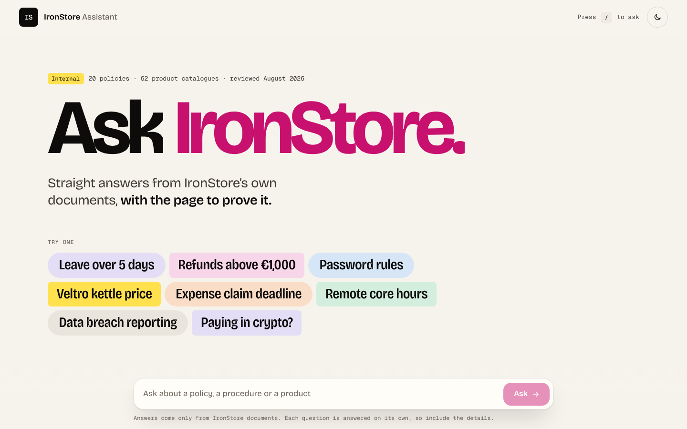
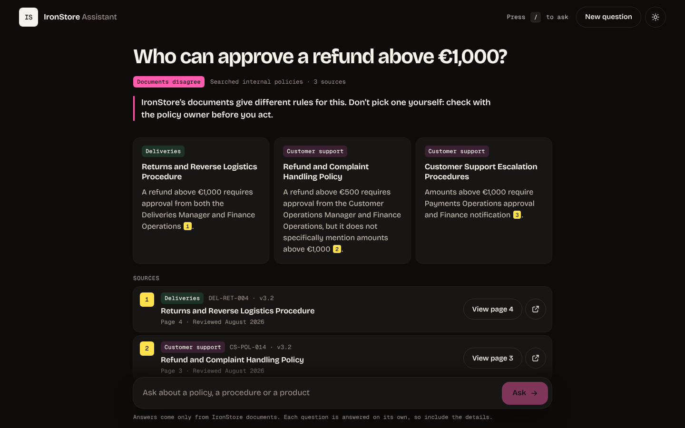
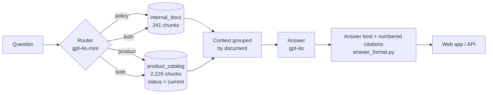

# IronStore Assistant

A conversational assistant for IronStore's internal documents: 20 policies and procedures and 63 product catalogues.
It answers **only** from those documents, cites the **document and page** for every claim, says when the documents
**disagree**, and says so when it **can't answer**.

Ironhack AI Engineering bootcamp · Week 7 mini-project · LangChain 0.2 · OpenAI · Chroma · FastAPI

**Live demo: https://ironstore-assistant.onrender.com** (Render free plan: the first visit after a pause can take up to a minute while the server wakes up)



## What the brief asked for, and how it's covered

| Requirement | How |
|---|---|
| Accurate, trustworthy answers | Retrieval-augmented generation over the PDFs; the prompt only allows answers from the retrieved context |
| Admit when it can't answer | Exact fallback sentence, shown in the interface as *Not in the documents* |
| Duplicated, inconsistent or outdated content | Outdated 2021 catalogue detected at indexing and filtered out of every search; conflicting rules shown side by side as *Documents disagree* |
| Bonus: citations (document + part, with a link) | Every claim gets a numbered footnote; each source card links to the PDF **at the cited page** |
| Bonus: API + frontend | FastAPI (`/ask`, `/ask/stream`, `/health`) and a one-page web app served by the same API |
| Bonus: deploy | Render Blueprint (`render.yaml`) |



## How it works



1. **Ingestion** (`ingest.py`, same steps as the notebook): PyPDF loads each page; every chunk keeps `source`, `page` (physical PDF page, 1-based), `area`, `doc_title`, `doc_id`, `version`, `last_reviewed` and, for catalogues, `status`.
2. **Routing**: a cheap model decides whether the question is about policies, products or both, so only the relevant collection is searched.
3. **Retrieval**: top 6 policy chunks and/or top 4 catalogue chunks (current catalogues only).
4. **Answer**: the context is grouped by document with a `[p. X]` marker on every block. The prompt asks for `[document title, p. X]` citations, a partial answer when the topic is covered but the value isn't, and to start with *The documents differ:* when rules conflict.
5. **Packaging**: `answer_format.py` classifies the answer (answered, partial, conflict, not found), numbers the citations and attaches the PDF link. It also flags a cited page the model was never given.

## Key decisions

| Decision | Why |
|---|---|
| Two Chroma collections (policies / catalogue) | Very different documents: a catalogue question shouldn't compete with 341 policy chunks, and the router can skip a whole collection |
| Chunks 1000/150 for policies, 1500/200 for catalogues | Policy rules are short sections; catalogue entries are longer and must keep price, stock and SKU together |
| `text-embedding-3-small` | Cheap (whole corpus ≈ $0.02) and accurate enough for clear business text |
| Router on `gpt-4o-mini`, answers on `gpt-4o` | Routing is an easy one-word task. With grouped context, `gpt-4o-mini` cited the wrong page and missed conflicts; `gpt-4o` fixed both |
| Context grouped by document | Makes the model compare documents one by one, which surfaced all three refund rules instead of one |
| Catalogue "Page N" labels rewritten to "Section:" | The catalogues print their own page numbers, which differ from the PDF page; citations now point to the page that opens |
| Outdated catalogue kept in the index with `status: outdated` | Filtered at search time: the data stays auditable, and the filter is one line |
| Streaming endpoint with real progress steps | Answers take 5–10 s; users see *Choosing where to look → Searching → Writing* instead of a spinner |
| LangChain pinned to 0.2.x | The version used in the course; `requirements.txt` pins the exact versions of the local environment |

## What we found in the data

- **Outdated content:** `IronStore_Old_Product_Catalog_2021.pdf` (reviewed December 2021) has prices that differ from the 2026 catalogues. It's excluded from search; the evaluation checks that its monitor price (€149.99) never appears.
- **Conflicting rules for refunds above €1,000:**
  - *Returns and Reverse Logistics Procedure* p. 4: Deliveries Manager + Finance Operations.
  - *Refund and Complaint Handling Policy* p. 3: above €500, Customer Operations Manager + Finance Operations. The same policy also has a second, different table.
  - *Customer Support Escalation Procedures* p. 4: Payments Operations approval + Finance notification.
- **Duplicate document ID:** `CS-POL-014` is used by both the Refund policy and the Escalation procedures.
- **Missing values:** the Leave policy gives no number of annual leave days; it says the entitlement is in PeopleHub and the employment contract.
- **Simplified copies:** the Employee Handbook summarises the leave-notice rule less precisely than the Leave policy.
- **Header formats vary** ("Document ID", "Policy ID", "Policy reference"; "Last reviewed" vs "Last reviewed in"), so the parser tries each one.

## Evaluation

16 test questions in the notebook (step 17), checked automatically for required and forbidden phrases:
9 single-document policy facts, 2 product questions, 3 traps (outdated price, conflicting refund rules, missing leave days) and 2 out-of-scope questions.

**Score: 15 / 16.** The one failure: *"How many days of annual leave do employees get?"* is answered with *I could not find this* instead of a partial answer pointing to PeopleHub and the contract. It's safe (it doesn't invent a number), but less helpful than it should be.

## Known limitations

- The leave-days question above: the partial-answer rule isn't always applied.
- Each question is answered on its own: there's no conversation memory, so follow-ups must repeat the context. The interface says so.
- Retrieval is plain similarity search (no re-ranking or hybrid keyword search). Exact codes such as SKUs work because they appear in the chunk text, but rare terms can be missed.
- The answer kind (partial / conflict / not found) is read from the wording of the answer, not from structured output.
- The free Render plan sleeps when idle and rebuilds the index on every deploy (about 1–2 minutes, about $0.02).
- Rate limits are kept in memory (6 questions per minute per visitor, 300 per day), so they reset when the server restarts.

## Project structure

```
01_exploration_and_ingestion.ipynb   exploration, indexing, router, evaluation (steps 1–18)
ingest.py                            builds chroma_db/ from documents/ (same logic as the notebook)
rag.py                               retrievers, router, prompt, answer and streaming pipeline
answer_format.py                     answer kind + numbered citations (no LangChain, easy to test)
api.py                               FastAPI: /health, /ask, /ask/stream, web app, PDFs, rate limit
static/index.html                    the web app (HTML + CSS + JS, no build step)
static/fonts/                        Bricolage Grotesque + Geist Mono (SIL Open Font License)
documents/                           the 83 IronStore PDFs (synthetic, from the brief)
docs/DESIGN.md                       interface study: audit, references, tokens, states, motion, accessibility
docs/BRIEF.md                        the project brief
test/                                fake API with canned answers + Playwright/axe interface test
render.yaml, requirements.txt        deployment
```

## Run it locally

Python 3.12 (the conda env `langchain-v0.2.x` was used).

```bash
pip install -r requirements.txt
cp .env.example .env          # then add your OPENAI_API_KEY
python ingest.py              # builds chroma_db/ (about 1–2 min, about $0.02)
uvicorn api:app --reload      # open http://127.0.0.1:8000
```

## API

| Method | Path | Returns |
|---|---|---|
| GET | `/health` | `{status, internal_chunks, catalog_chunks, policies, catalogues, retired, last_reviewed}` |
| POST | `/ask` | `{"question": "..."}` → `{answer, answer_marked, kind, route, model, citations[]}` |
| POST | `/ask/stream` | Same answer as NDJSON events: `status` (routing, searching, writing) → `delta` (text) → `done` (full payload) or `error` |
| GET | `/documents/...pdf#page=N` | The source PDFs, so citation links open at the right page |

A citation looks like this:
`{"n": 1, "title": "Product Catalog - Home Appliances", "page": 21, "url": "/documents/product_catalog/IronStore_Product_Catalog_Home_Appliances.pdf#page=21", "doc_id": "IS-HAP-2026.08", "area": "Product catalogue", "last_reviewed": "August 2026", "page_was_read": true}`

Questions are limited to 500 characters; too many requests return `429` with a readable message.

## Deploy (Render)

1. On render.com: **New → Blueprint**, then pick this repository. `render.yaml` sets the build (`pip install -r requirements.txt && python ingest.py`) and the start command (`uvicorn api:app --host 0.0.0.0 --port $PORT`).
2. Enter `OPENAI_API_KEY` when asked. It's stored in Render only, never in the repo.
3. Optional: change `RATE_PER_MINUTE` and `DAILY_CAP` in the service's environment settings.

## Interface

One page, light and dark, keyboard and screen-reader friendly (WCAG 2.1 AA, checked with axe-core: 0 violations).
Visual references: toyfight.co (tag collage, highlighter labels, `/` shortcut) and hugeinc.com (oversized type, magenta accent word, numbered lists).
The full study, with audit, tokens, answer states and copy, motion and accessibility, is in [docs/DESIGN.md](docs/DESIGN.md).

Interface test without spending API credit:

```bash
uvicorn test.fake_api:app --port 8765    # canned answers
npm i playwright axe-core && node test/ui_test.js
```

## Credits

Documents and brief: Ironhack (synthetic company data). Fonts: Bricolage Grotesque and Geist Mono, SIL Open Font License 1.1.
Built by Joey with Claude as pair programmer.
